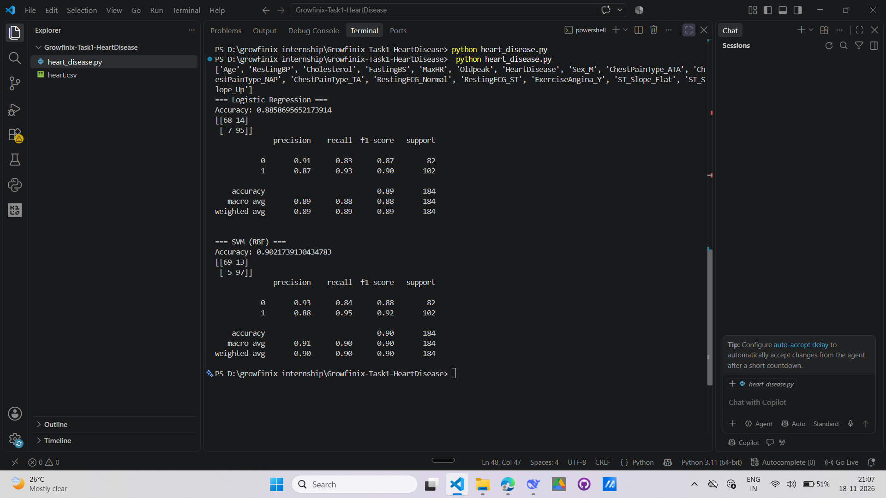

# Growfinix Internship - Task 1: Heart Disease Prediction

## Tech Stack
Python, Pandas, Scikit-Learn (Logistic Regression, SVM)

## Description
Predict heart disease risk from patient health metrics. Focus on data cleaning and feature scaling (StandardScaler).

## How to Run
1. pip install pandas scikit-learn
2. Place heart.csv in this folder
3. python heart_disease.py

## Results
