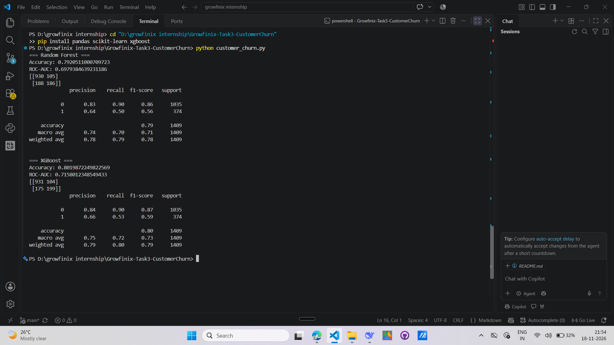

# Growfinix Internship - Task 3: Customer Churn Prediction

## Tech Stack
Python, Pandas, Scikit-Learn (Random Forest), XGBoost

## Description
Predict which telecom customers are likely to churn based on account, service, and billing features.

## How to Run
1. pip install pandas scikit-learn xgboost
2. Place WA_Fn-UseC_-Telco-Customer-Churn.csv in this folder
3. python customer_churn.py

## Results

